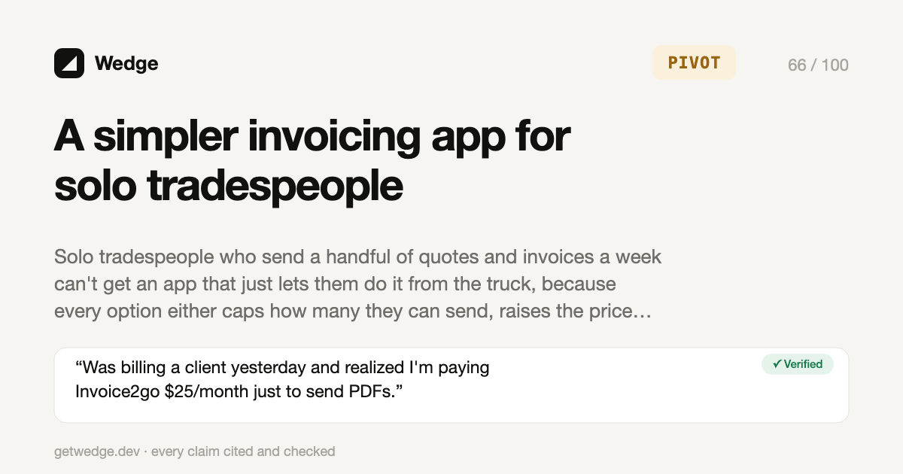

<p align="center">
  
</p>

<h1 align="center">◢ Wedge</h1>

<p align="center"><b>Find the gap. Take the customers.</b><br>
Open-source agent skills that find a business worth building, show exactly what customers hate about the competition, and tell you how to win. Every claim is cited and checked.</p>

<p align="center">
  <a href="https://getwedge.dev">getwedge.dev</a> ·
  <a href="https://getwedge.dev/examples/tradesperson-invoicing/">Example report</a> ·
  <a href="#install">Install</a> ·
  <a href="#how-it-works">How it works</a>
</p>

```bash
npx skills add senavoh/wedge
```

Then ask your agent:

> Use wedge to find me a business I can start with $500 and 10 hours a week.

Works with **Claude Code, Codex, Cursor, Gemini CLI, OpenCode**, and any agent that reads `SKILL.md` files.

<p align="center">
  
  <br><sub>What your agent runs under the hood, from a real run (output trimmed). Rebuild with <code>python3 docs/make_demo.py</code>.</sub>
</p>

---

## Why Wedge

Ask an AI for business ideas and you get confident, generic, unsourced lists. Wedge works differently:

- **Evidence or it didn't happen.** Every pain point and claim about a competitor links to a real review, thread or pricing page. `verify.py` re-fetches each source and checks that the quote is actually there. A claim needs two verified sources from different URLs, or it's labeled **unverified** and can't drive the verdict.
- **It argues with itself.** A separate critic pass tries to kill the top idea (who already tried, a free incumbent, people who complain but won't pay) before anything is ranked.
- **It's honest.** The verdict is **GO**, **PIVOT** or **KILL**, with the reasoning shown. If it couldn't reach any real customers' words (every source blocked or empty), it says **INCONCLUSIVE** and tells you how to finish, instead of guessing.
- **It tells you how to win, not only what to build.** It finds switching triggers, positioning in customers' own words, offers that pull switchers, where unhappy customers hang out, and drafts comparison pages and outreach.
- **It's free to run.** No API keys, no paid data. The scripts use only the Python standard library.
- **It picks up where it left off.** Everything is saved in `ideas/<slug>/`, so a run can continue tomorrow or in a different agent.

## Four ways to start

| Mode | Say something like |
|---|---|
| **From scratch** | "Find me a business I can start." |
| **From what you know** | "I run an IT company. What could I build?" |
| **Stress-test an idea** | "Is a dog-walking app for apartment buildings any good?" |
| **Beat my competitors** | "How do I take customers from Jobber?" |

Choose **quick** (about 5 to 10 minutes) or **deep** (the full run; our timed deep run took 29 minutes and read over 1,400 pages).

## How it works

```
founder fit → niche scout → competitor map → review mining → gap ranking → critic → win plan → launch kit → verify → report
```

1. **Founder fit.** Five quick questions (budget, skills, hours, risk, online or local) so ideas are ranked for you.
2. **Niche scout.** Mines "I wish there was…", "alternative to…" and "too expensive" posts to find unmet demand.
3. **Competitor map.** Real pricing, positioning and a feature matrix, all cited.
4. **Review mining.** Turns hundreds of 1 to 3 star reviews and complaint threads into ranked pain themes with exact quotes.
5. **Gap ranking.** Scores six axes (pain, willingness to pay, competition gap, founder fit, reachability, build cost) and shows the reasoning.
6. **Critic.** A skeptical second pass tries to kill the winner.
7. **Win plan.** Switching triggers, positioning, offers, what to build first, where to find unhappy customers, and draft assets.
8. **Launch kit.** A name with a verified-available domain, pricing, the cheapest stack, a landing page, and a 7-day test with a pass bar and kill criteria.
9. **Verify and report.** Every quote is checked, then rendered into one self-contained HTML report and a share card.

## See real runs

**16 real runs. 0 GO.** That isn't a bug. Wedge only says GO when the pain is sharp, people already pay, nobody serves them well, you can reach them for free, and a skeptical critic can't find a sourced reason it fails. Most markets with public complaints already have someone serving them, so most ideas come back PIVOT or KILL. Better to hear that before you build than after.

Every run below is unedited, and every quote links to its source. Re-check any of them with `verify.py`. One of them is Wedge stress-testing a paid version of itself (KILL), and one is Wedge testing its own pivot (the score went down).

| Run | Mode | Verdict | What it found |
|---|---|---|---|
| [A simpler invoicing app for solo tradespeople](https://getwedge.dev/examples/tradesperson-invoicing/) ([files](examples/tradesperson-invoicing/)) | Stress-test an idea | **PIVOT 66** | Invoice caps and price hikes are real pain, but indie builders already make the generic app. Build the uncapped, price-locked, offline version. |
| [What WooCommerce plugin to build next](https://getwedge.dev/examples/woocommerce-plugin-opportunity/) ([files](examples/woocommerce-plugin-opportunity/)) | From what you know | **PIVOT 61** | Official Meta and Google sync plugins are rated 2.1 and 2.7 across 1.2M installs. But paid feed plugins already sell large-catalog sync. |
| [↳ Follow-up: a sync-health monitor for those stores](https://getwedge.dev/examples/woo-sync-health-monitor/) ([files](examples/woo-sync-health-monitor/)) | Stress-test the pivot | **PIVOT 54** | Wedge tested its own pivot. A near-twin exists, nobody pays for monitoring alone, and Google now pushes status changes for free. Score went down. |
| [What public Shopify app to build](https://getwedge.dev/examples/shopify-app-opportunity/) ([files](examples/shopify-app-opportunity/)) | From what you know | **PIVOT 58** | Stocky's shutdown left a label-printing gap, but free purchase-order apps already print labels. |
| [Tools for Shopify merchants, from a small Shopify merchant](https://getwedge.dev/examples/shopify-merchant-tools/) ([files](examples/shopify-merchant-tools/)) | From what you know | **PIVOT 57** | Same Stocky gap, found from the merchant side. Sell a done-for-you setup service instead of another app. |
| [Taking customers from Bookly and Amelia](https://getwedge.dev/examples/wordpress-booking-plugin/) ([files](examples/wordpress-booking-plugin/)) | Beat my competitors | **PIVOT 63** | Updates that break bookings drive people away, but good alternatives and importers exist. Lead with a rescue and migration service. |
| [Local delivery and pickup scheduling for Shopify](https://getwedge.dev/examples/shopify-local-delivery/) ([files](examples/shopify-local-delivery/)) | Stress-test an idea | **PIVOT 56** | The pain is real, but Pickeasy is rated 4.9 from 1,327 reviews with a free plan, in a category of about 70 apps. |
| [A cheaper route app than Skimmer for pool cleaners](https://getwedge.dev/examples/pool-service-software/) ([files](examples/pool-service-software/)) | Stress-test an idea | **PIVOT 56** | Six reviewers describe per-pool price hikes, but cheaper apps already exist. Win on a price lock and offline use, not price. |
| [A booking app for mobile dog groomers](https://getwedge.dev/examples/dog-grooming-software/) ([files](examples/dog-grooming-software/)) | Stress-test an idea | **PIVOT 55** | Groomers complain about MoeGo, but two cheaper "switching from MoeGo?" apps already exist. |
| [Find me a business (deep run)](https://getwedge.dev/examples/wordpress-event-ticketing/) ([files](examples/wordpress-event-ticketing/)) | From scratch, **deep** | **PIVOT 55** | Scouted 7 niches and picked WordPress event ticketing, then pivoted to selling to agencies. 29 minutes. |
| [A $4.99/month Pomodoro app for students](https://getwedge.dev/examples/pomodoro-timer-app/) ([files](examples/pomodoro-timer-app/)) | Stress-test an idea | **PIVOT 54** | People are angry at focus apps that added subscriptions, which is exactly what this would be. Sell it once instead. |
| [An app for independent music teachers](https://getwedge.dev/examples/music-teacher-studio/) ([files](examples/music-teacher-studio/)) | From what you know | **KILL 56** | My Music Staff and free tiers already cover scheduling and billing, and many teachers say free tools are enough. |
| [A paid, hosted version of Wedge itself](https://getwedge.dev/examples/hosted-wedge/) ([files](examples/hosted-wedge/)) | Stress-test an idea | **KILL 54** | We ran Wedge on Wedge. GummySearch's shutdown is real, but GripeFind already sells the same pitch at the same price. |
| [A $9/month SSL certificate expiry monitor](https://getwedge.dev/examples/ssl-expiry-monitor/) ([files](examples/ssl-expiry-monitor/)) | Stress-test an idea | **KILL 47** | Expiry emails are already free from several tools, and the people who feel the pain fix it with a script. |
| [A Peppol e-invoicing plugin for Belgian web shops](https://getwedge.dev/examples/belgium-peppol-woocommerce/) ([files](examples/belgium-peppol-woocommerce/)) | Stress-test an idea | **KILL 46** | The law is real and in force, but the invoicing plugin shops already use sends over Peppol for about €5 a month. |
| [Software for small independent funeral homes](https://getwedge.dev/examples/funeral-home-software/) ([files](examples/funeral-home-software/)) | Stress-test an idea | **KILL 42** | About 30 products, including a free tier, and most directors' reviews praise the tool they already use. |

What would a GO take? See [what each verdict means](skills/wedge/references/scoring.md). If you get a real one, open a pull request and add it under `examples/`.

## The skills

| Skill | What it does |
|---|---|
| `wedge` | Runs the whole pipeline, keeps state, verifies and renders the report. |
| `wedge-niche-scout` | Finds niches with unmet demand that fit you. |
| `wedge-competitor-map` | Pricing, positioning and a feature matrix for every competitor. |
| `wedge-review-miner` | Pain themes from real reviews and threads, with exact quotes. |
| `wedge-gap-ranker` | Scoring, the critic pass, and GO / PIVOT / KILL. |
| `wedge-win-plan` | How to pull customers from competitors. |
| `wedge-launch-kit` | Name and domain, pricing, stack, landing page, 7-day test. |
| `wedge-watch` | Monthly re-check of competitors: new complaints, price changes, new entrants. |

Each skill works on its own too: "Use wedge-review-miner on Jobber and Housecall Pro."

## Install

**Any agent (recommended)**

```bash
npx skills add senavoh/wedge
```

The `skills` installer needs Node.js 22 or newer. On older Node versions, use the install script below.

**Claude Code plugin**

```text
/plugin marketplace add senavoh/wedge
/plugin install wedge@wedge
```

**Install script.** Copies the skills into every agent skills folder it finds (`~/.claude`, `~/.codex`, `~/.gemini`, `~/.cursor`, `~/.config/opencode`, `~/.agents`):

```bash
curl -fsSL https://getwedge.dev/install.sh | sh
```

To choose the folders yourself, pass them after `sh -s --`:

```bash
curl -fsSL https://getwedge.dev/install.sh | sh -s -- ~/.claude/skills ~/.codex/skills
```

**Manual.** Copy the folders in `skills/` into your agent's skills folder.

Requirements: Python 3.8 or newer, which is preinstalled on macOS and most Linux systems.

**Optional, for Reddit.** Reddit blocks anonymous requests from many networks. Without keys, Wedge uses your agent's own web search for Reddit (`site:reddit.com`) and leans on sources that need no keys, such as app store and plugin marketplace reviews. If you already have approved Reddit API access, set `REDDIT_CLIENT_ID` and `REDDIT_CLIENT_SECRET` to use the official API. New Reddit apps now need Reddit's approval under its [Responsible Builder Policy](https://support.reddithelp.com/hc/en-us/articles/42728983564564-Responsible-Builder-Policy), so don't count on getting keys quickly. `GITHUB_TOKEN`, if set, raises GitHub's rate limit.

## The scripts

The agent runs these for you. They live in `skills/wedge/scripts/` and you can run them yourself too:

| Script | Does |
|---|---|
| `fetch.py` | Pulls customer voice from Hacker News, Reddit, App Store reviews, GitHub issues and any web page, as JSONL. `pages` fetches many URLs in parallel, and `links` collects review links to feed into it. |
| `signals.py` | Turns raw records into a short, cited digest of pain and demand signals, so the agent reads 100 lines instead of 100,000. |
| `verify.py` | Re-fetches every cited source, checks the quote is there, and applies the two-source rule. |
| `domain.py` | Checks domain availability through public RDAP, and reports "unknown" instead of guessing. |
| `state.py` | Saves progress so any agent can resume a run. |
| `report.py` | Renders the HTML report and the share card. |

## How much does a run cost?

Wedge uses your agent's normal usage. There are no API keys and no paid data. It's built to keep that usage low:

- **Quick mode is the default.** Deep mode runs only when you ask for it.
- **Raw pages never enter the conversation.** The scripts save them to disk, and the agent reads a short digest instead. `signals.py --find` pulls out only the sentences worth quoting.
- **Extras are on request.** In quick mode, the landing page and the outreach and comparison drafts are offered at the end instead of always built.

Measured across several test runs with the same model, a quick run used about **100k tokens** and took 2 to 6 minutes. A run that hits the evidence floor (150+ records, 15+ customer quotes) costs about the same, because the extra pages are saved to disk, not read. A deep run, which scouts 7 niches and reads over 1,400 pages, took 29 minutes and used a few times that. To spend even less, run a single skill, for example "use wedge-review-miner on Jobber and Housecall Pro".

## Data and ethics

- Wedge reads public posts and reviews through official or public endpoints: the Hacker News Algolia API, Reddit's JSON and official API, Apple's public review feeds and the GitHub API. It doesn't scrape sites whose terms forbid it. G2, Capterra and Trustpilot content comes in only through ordinary web search results.
- Quotes are short, attributed and linked, used to support analysis.
- The win plan never suggests fake reviews, astroturfing or misleading comparisons.

## Contributing

Issues and pull requests are welcome. Good first contributions: new data sources that need no keys, better signal patterns for non-English markets, and example runs in new industries (add them under `examples/`).

## License

MIT
